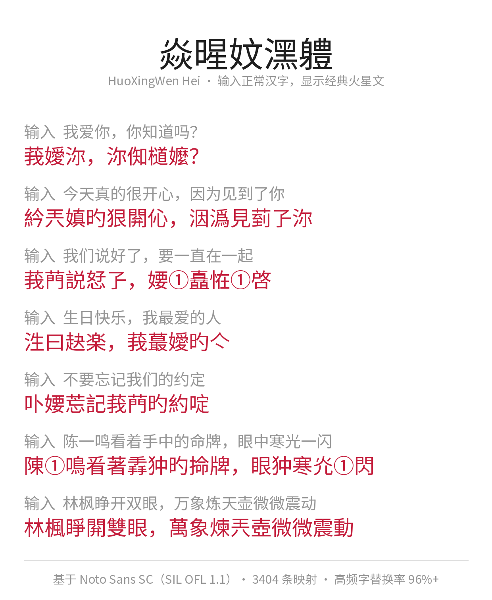

# 火星文黑体 HuoXingWen Hei

一款「输入正常汉字，显示经典火星文」的中文显示字体。装上它，打字秒回 2000 年代的 QQ 聊天室。



## ✨ 这是什么

**火星文黑体**不是文本转换器，而是一个真正的 TTF 字体：通过重写字体内部的 cmap（字符映射表），把 GB2312 常用汉字的字形直接替换为对应的火星文字形。

- 在 Word / 记事本 / PS / 网页里正常打字 → 屏幕上直接显示火星文
- 我 → 莪、你 → 沵、的 → 旳、爱 → 嬡、天 → 兲、笑 → 咲、一 → ①
- 覆盖 GB2312 全部 6763 个汉字，日常口语替换率 96%+
- 字形底子为 [Noto Sans SC](https://github.com/notofonts/noto-cjk)（思源黑体）Regular

## 📥 安装使用

1. 下载 `fonts/HuoXingWenHei-Regular.ttf`
2. Windows：右键 → 安装；macOS：双击用「字体册」安装
3. 在任意软件中把字体切换为 **「火星文黑体 / HuoXingWen Hei」**
4. 正常打字即可

网页使用（WebFont）：

```css
@font-face {
  font-family: "HuoXingWen Hei";
  src: url("fonts/HuoXingWenHei-Regular.ttf") format("truetype");
}
.martian { font-family: "HuoXingWen Hei"; }
```

## 🔧 映射表怎么来的

映射表由三层来源合并，并剔除了字形视觉无变化的无效项：

| 层级 | 来源 | 说明 |
|---|---|---|
| 1 | 人工整理（`scripts/mars_manual.py`） | 经典火星文搭配，约 700 条候选 |
| 2 | OpenCC 简转繁 | 一 → 壹 类借用繁体/异体，2107 条 |
| 3 | Unihan kSemanticVariant / kZVariant | Unicode 官方异体字数据，845 条 |

合并后 GB2312 覆盖率约 50.3%（其余为无合适火星文字形的字，保留原样）。完整映射见 `data/mapping.json`。

## 🛠️ 自己构建

```bash
pip install fonttools opencc-python-reimplemented

# 1. 准备两个数据文件，放到 scripts/ 目录：
#    - NotoSansSC-VF.ttf（可变字体）
#      https://github.com/notofonts/noto-cjk/releases
#    - Unihan_Variants.txt
#      https://www.unicode.org/Public/UCD/latest/ucd/Unihan_Variants.txt
# 2. 生成映射表
cd scripts && python build_mapping.py
# 3. 生成字体
python make_font.py
```

## 📄 许可证

**SIL Open Font License 1.1**（见 [OFL.txt](OFL.txt)）

- 本字体基于 [Noto Sans SC](https://github.com/notofonts/noto-cjk) 改造，遵循其原许可证
- 可自由使用、学习、修改和再分发（个人与商业均可）
- 再分发时必须保留本许可证
- 不得单独出售字体文件本身

## ⚠️ 免责声明

火星文映射以娱乐为目的，部分映射借鉴异体字/繁体字，不代表任何语言学规范。用于正式文档前请三思 😄
